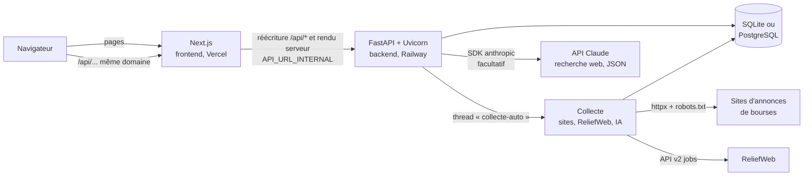
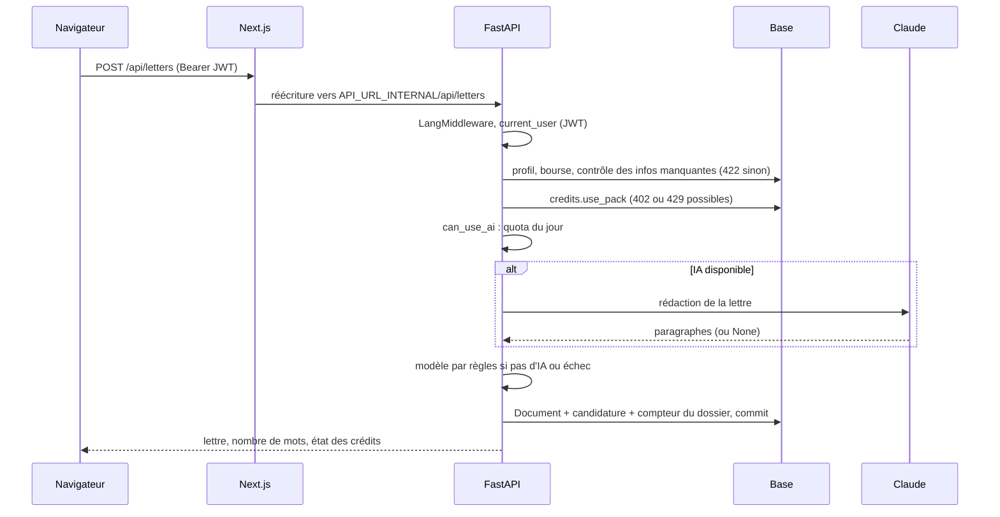

# ScholarFit : architecture technique

Ce document s'adresse aux développeurs qui reprennent le projet. Il décrit le code tel qu'il est dans ce dépôt (API version 0.2.0). Pour l'installation pas à pas et la mise en ligne, voir `README.md` et `DEPLOIEMENT.md`.

ScholarFit aide les étudiants à trouver les bourses, stages et conférences auxquels ils ont droit, à préparer leur CV et leur lettre pour chaque bourse, à suivre leurs candidatures et, s'ils le souhaitent, à être accompagnés par un conseiller (offres payantes).

## 1. Vue d'ensemble

Deux applications séparées, dans un seul dépôt :

| Dossier | Rôle | Technologies | Hébergement prévu |
|---|---|---|---|
| `frontend/` | Site web (pages, formulaires, espace candidat, administration) | Next.js 15.5, React 19.1, TypeScript 5.9, Tailwind CSS 4.3 | Vercel |
| `backend/` | API, base de données, collecte des bourses, matching, CV et lettres, accompagnement, paiements déclaratifs | Python 3.13, FastAPI, Uvicorn, Pydantic 2, SQLAlchemy 2, SQLite ou PostgreSQL | Railway (image Docker) |



Version texte du même schéma :

```
Navigateur ──► Next.js (Vercel) ──/api/*──► FastAPI (Railway) ──► SQLite / PostgreSQL
                                              │
                                              ├─ thread collecte-auto ──► sites d'annonces (httpx, BeautifulSoup)
                                              │                        ├─► API ReliefWeb (stages)
                                              │                        └─► API Claude (découverte web)
                                              └─ CV, lettres, compatibilité ──► API Claude (facultatif)
```

Principe structurant : **l'IA est facultative**. Sans `ANTHROPIC_API_KEY`, toutes les fonctions marchent par règles et modèles de texte (`backend/app/ai/client.py` renvoie `None` et chaque module utilise sa version hors ligne). Seules la découverte IA des bourses et la traduction automatique des nouvelles fiches sont alors inactives.

## 2. Arborescence

```
plateforme-bourses/
├── .github/workflows/ci.yml     CI : tests backend + typecheck et build frontend
├── docker-compose.yml           PostgreSQL 16 + API + site, pour tout lancer en local
├── start.ps1 / start.sh         Lancement local sans Docker (Windows / Linux-macOS)
├── README.md, DEPLOIEMENT.md
├── backend/
│   ├── Dockerfile               python:3.13-slim, « seed » puis uvicorn sur le port 8000
│   ├── requirements.txt         dépendances de base (SQLite)
│   ├── requirements-postgres.txt  + psycopg[binary]
│   ├── requirements-dev.txt     + pytest
│   ├── .env.example
│   ├── tests/                   47 tests pytest (hors ligne, SQLite)
│   └── app/
│       ├── main.py              application FastAPI, middlewares, routeurs, démarrage du planificateur
│       ├── config.py            réglages (pydantic-settings, lit .env)
│       ├── db.py                moteur SQLAlchemy, création des tables, ajout des colonnes manquantes
│       ├── models.py            tables (voir §4)
│       ├── schemas.py           schémas Pydantic des entrées/sorties
│       ├── security.py          mots de passe PBKDF2, jetons JWT, dépendances current_user / admin_user
│       ├── i18n.py              FR/EN : middleware de langue, fonction t(fr, en)
│       ├── routers/             points d'entrée HTTP (voir §5)
│       ├── matching.py          moteur de matching profil / bourses
│       ├── deadlines.py, details.py, geo.py, vocab.py   dates limites, fiches détaillées, régions, vocabulaires
│       ├── ai/                  client Claude, chat, CV, lettres, compatibilité, formats par pays
│       ├── export.py            PDF (ReportLab) et Word (python-docx) des CV et lettres
│       ├── fonts/               polices Carlito et Caladea (licence OFL) pour les PDF
│       ├── credits.py           dossiers CV + lettre et commandes de paiement
│       ├── offers.py, coaching.py   offres et logique de l'accompagnement
│       ├── alerts.py            alertes et rappels (dans l'application)
│       ├── linkcheck.py         vérification des liens officiels
│       ├── translate.py         version anglaise des fiches
│       ├── scheduler.py         collecte automatique dans un thread
│       ├── cli.py               commandes « python -m app.cli … »
│       ├── scrapers/            collecte (voir §6)
│       └── data/                sources.json, scholarships.json (+ _en), build_seed.py
└── frontend/
    ├── next.config.mjs          output standalone + réécriture /api/* vers FastAPI
    ├── Dockerfile               build Node 22 puis image standalone
    ├── app/                     pages (App Router), voir §3
    ├── components/              composants (Shell, cartes, globe, chat, accompagnement, docs/…)
    ├── lib/                     api.ts (client HTTP), useAuth.ts, i18n*, theme.ts, geo.ts…
    └── public/                  logos, drapeaux SVG, logos des moyens de paiement
```

## 3. Frontend (Next.js)

**Pages** (`frontend/app/`, App Router) : accueil `/`, liste `/bourses` et fiche `/bourses/[id]`, `/questionnaire`, `/mes-bourses`, `/profil`, `/cv`, `/lettre/[id]`, `/preparer/[id]`, `/suivi`, `/accompagnement`, `/conseiller` et `/conseiller/[id]`, `/admin`, `/connexion`, `/soutenir`.

**Appels à l'API.** Le navigateur appelle toujours `/api/...` sur le domaine du site. `next.config.mjs` réécrit `/api/:path*` vers `${API_URL_INTERNAL}/api/:path*`. Il n'y a donc pas de CORS en usage normal. `NEXT_PUBLIC_API_URL` ne sert que si l'on veut que le navigateur appelle directement un autre domaine ; dans ce cas `CORS_ORIGINS` côté API doit contenir l'adresse du site.

**Rendu.** La plupart des pages sont des composants client (`"use client"`) qui passent par `lib/api.ts`. La fiche `/bourses/[id]` est rendue côté serveur (indexable) : elle appelle directement `API_URL_INTERNAL` avec `fetch`.

**Authentification côté client.** Le jeton JWT est stocké dans `localStorage` (clé `bm_token`) et envoyé en `Authorization: Bearer`. `lib/useAuth.ts` charge `/api/auth/me` et écoute l'événement `auth-change`. Une réponse 401 efface le jeton. `components/RequireAuth.tsx` protège les pages réservées aux comptes.

**Langue et thème.** Le cookie `sf_lang` (fr par défaut, en possible) est lu côté serveur (`lib/i18n-server.ts`) et côté client ; `api.ts` ajoute `?lang=en` aux appels. Le thème sombre/clair est appliqué avant le rendu par un script en ligne (`lib/theme.ts`, injecté dans `layout.tsx`).

## 4. Backend (FastAPI)

**Démarrage** (`main.py`, `lifespan`) : `init_db()` crée les tables manquantes et ajoute les colonnes manquantes, puis chargement des traductions anglaises des fiches de départ, puis démarrage du thread de collecte (`scheduler.start()`).

**Middlewares** : `LangMiddleware` (langue depuis `?lang=` ou le cookie `sf_lang`, rangée dans une `ContextVar`), puis `CORSMiddleware` (origines de `CORS_ORIGINS`).

**Base de données** (`db.py`). SQLAlchemy 2 en mode synchrone. SQLite par défaut (`sqlite:///./bourses.db`), PostgreSQL via `postgresql+psycopg://…`. Il n'y a **pas d'Alembic** : `create_all` puis `_add_missing_columns()` ajoute par `ALTER TABLE` les colonnes apparues dans `models.py`. Cela ne gère ni les renommages, ni les suppressions, ni les changements de type.

**Tables** (`models.py`) :

| Table | Contenu |
|---|---|
| `sources` | Sources de collecte, dernier passage, statut, robots.txt |
| `scholarships` | Opportunités (`kind` : bourse, stage, conference), conditions, pays, date limite, état du lien, traduction |
| `users` | Comptes (`is_admin`, langue) |
| `profiles` | Profil candidat : niveau, nationalités, notes, langues, CV importé, projet… |
| `applications` | Suivi des candidatures, checklist des pièces, lettre |
| `documents` | CV original, CV adaptés, lettres (texte + données structurées en JSON) |
| `alerts` | Alertes et rappels affichés dans l'application |
| `ai_usage` | Compteur quotidien d'appels IA par compte |
| `advisors` | Conseillers (niveaux, pays, domaines, langues, capacité) |
| `coachings`, `coaching_steps`, `coaching_messages`, `coaching_meetings` | Accompagnement : demande, plan, messagerie, rendez-vous |
| `doc_packs` | Dossiers CV + lettre ouverts (un par bourse et par compte) |
| `credit_orders` | Paiements déclarés pour des dossiers supplémentaires |

**Sécurité** (`security.py`). Mots de passe en PBKDF2-SHA256 (310 000 itérations, bibliothèque standard). Jetons JWT HS256 signés avec `SECRET_KEY`, valables 7 jours (`token_expire_minutes`). Dépendances FastAPI : `current_user`, `optional_user`, `admin_user`. Un administrateur est un compte avec `is_admin` ; le compte créé par `seed` est le premier e-mail de `ADMIN_EMAILS`.

**Quota IA** (`quota.py`). L'IA n'est utilisée que pour un compte connecté, avec un plafond de `AI_FREE_GENERATIONS_PER_DAY` (20) appels par jour. Au-delà, le repli par règles prend le relais.

**Client Claude** (`ai/client.py`). SDK `anthropic`, modèle `CLAUDE_MODEL`. Trois fonctions : `ask_text`, `ask_json` (sortie contrainte par schéma JSON) et `ask_web` (outil de recherche web côté serveur, pour la découverte). Toute erreur (limite de débit, erreur API, connexion, refus, réponse tronquée) renvoie `None` et déclenche le repli hors ligne.

## 5. Points d'entrée de l'API

Documentation interactive : `/docs` (Swagger, générée par FastAPI). Résumé par routeur :

| Routeur | Préfixe | Principaux points d'entrée |
|---|---|---|
| `auth.py` | `/api/auth` | `register`, `login`, `me` (GET, DELETE), `email-disponible` |
| `scholarships.py` | `/api` | `GET /scholarships` (filtres, tri, pagination ; `country_exact=true&kind=…` pour un total exact par pays), `/scholarships/{id ou slug}`, `/meta`, `/stats`, `/stats/countries` |
| `profile.py` | `/api` | `GET/PUT /profile`, `POST /profile/cv` (PDF, .docx ou texte, 5 Mo max), `GET /matches` |
| `questionnaire.py` | `/api` | `GET/POST /questionnaire`, `GET /offres` |
| `chat.py` | `/api` | `POST /chat` : assistant de recherche, ouvert sans compte (3 résultats montrés aux visiteurs) |
| `applications.py` | `/api` | `/applications` (CRUD), `/applications/{id}/check`, `/alerts` |
| `ai.py` | `/api` | `/cv/review`, `/cv/adapt`, `/cv/adapted`, `/letters/{id}/context`, `/letters`, `/documents/{id}`, `/export/{cv|lettre}?fmt=pdf|docx`, `/scholarships/{id}/fit`, `/credits`, `/credits/orders`, `/admin/credit-orders` |
| `coaching.py` | `/api/accompagnement` et `/api/admin` | demande, détail, étapes, messages, rendez-vous, avis ; côté admin : attribution d'un conseiller, statut de paiement |
| `admin.py` | `/api/admin` | CRUD des bourses, vérification, liens cassés, sources et lancement d'une source, extraction d'une URL, maintenance |
| `main.py` | `/api/health` | état de l'API et mode IA |

## 6. Collecte des bourses

**Configuration** : `backend/app/data/sources.json` (18 sources, synchronisées dans la table `sources` à chaque passage). Connecteurs (`scrapers/collector.py`, dictionnaire `CONNECTORS`) :

| Connecteur | Sources actives | Fonctionnement |
|---|---|---|
| `json` | Données d'exemple (`scholarships.json`, 98 fiches) | Chargement au `seed` |
| `site` | 12 sites d'annonces actifs (Opportunity Desk, Scholars4Dev, After School Africa…), 1 désactivé | Flux RSS du site (`/feed/` par défaut) ; s'il donne moins de 5 liens, lecture de la page d'accueil ou des `paths` et tri des liens par mots-clés ; puis extraction de chaque annonce |
| `ai_discovery` | Découverte IA (monde entier) | Claude cherche sur le web, les 46 zones en un passage hebdomadaire (`scrapers/discovery.py`, liste `ZONES`) ; l'état de rotation est gardé dans `.cache/discovery_state.json` |
| `reliefweb` | Stages ONU, ONG, organisations internationales | API `https://api.reliefweb.int/v2/jobs`, type « Internship » ; demande `RELIEFWEB_APPNAME` (gratuit, sur apidoc.reliefweb.int) |
| `rss`, `page_list` | EURAXESS, Campus France (désactivés) | Flux RSS ; page liste + sélecteur CSS |

Les sources actives ont une fréquence hebdomadaire (`frequency_hours: 168`), pour limiter les requêtes ; l'API vérifie chaque jour ce qui est dû (`AUTO_COLLECT_HOURS=24`).

**Récupération polie** (`scrapers/base.py`, `PoliteFetcher`) : client `httpx` avec `SCRAPER_USER_AGENT`, respect de `robots.txt` (si robots.txt est injoignable, on s'abstient), délai minimal de `SCRAPER_MIN_DELAY_SECONDS` par domaine, cache disque de 24 h dans `backend/.cache/pages/`.

**Extraction** (`scrapers/extract.py`) : BeautifulSoup pour le texte et le lien officiel, puis règles (date limite, montant, niveaux) ou, si l'IA est disponible, une fiche structurée par `ask_json`. Les pages des sites d'annonces servent à repérer les opportunités ; on cherche le lien de l'organisme qui finance.

**Enregistrement** : `upsert()` avec dédoublonnage (`find_duplicate` : même slug, même lien officiel avec un titre proche, ou titre presque identique chez le même organisme, comparé par `difflib`). Les fiches trouvées par l'IA passent un test de lien avant d'entrer en base et restent marquées pour relecture dans l'administration.

**Cycle complet** (`scheduler.run_cycle()`) :

1. sources dues (`run_all(only_due=True)`) ;
2. expiration des dates dépassées (les bourses annuelles sont décalées d'un an et marquées « à vérifier ») ;
3. vérification des liens officiels (`linkcheck.py`) ;
4. traduction anglaise de 100 fiches au plus (`translate.py`, IA) ;
5. alertes de nouvelles bourses et rappels de dates limites à 30, 7 et 1 jours (`alerts.py`) ;
6. rappels de l'accompagnement (`coaching.run_reminders`).

Ce cycle tourne dans un **thread démon du processus de l'API** (`scheduler.py`) : premier passage 60 s après le démarrage, puis toutes les `AUTO_COLLECT_HOURS` heures (6 par défaut dans `config.py`). Avec `AUTO_COLLECT_HOURS=0`, rien ne tourne et il faut planifier `python -m app.cli nightly`.

## 7. Matching et compatibilité

**Matching** (`matching.py`), utilisé par `/api/matches` et par l'assistant `/api/chat` :

1. **Filtres durs** (`hard_filter`) : date limite dépassée, niveau visé, nationalité (listes éligibles et exclues), âge maximum, pays d'étude souhaités, financement complet exigé, public ciblé.
2. **Score sur 100** (`score`), pondérations dans `WEIGHTS` : domaine 30, proximité entre le projet et la description 25 (recouvrement de mots, sans IA), notes et langues 20, pays 15, financement 10.
3. **Explication** : raisons, éléments manquants, jours restants, niveau de chance.

Le tri ajoute un bonus d'urgence (jusqu'à +10 points) quand la date limite approche. Ce moteur est **entièrement à base de règles** : aucun modèle d'IA n'intervient dans le classement.

**Compatibilité avant de postuler** (`ai/fit.py`, `GET /api/scholarships/{id}/fit`) : réutilise `hard_filter`, `language_ok` et `score`, contrôle les pièces du dossier et la couverture des thèmes de la bourse par le CV, puis donne un score, un verdict et des améliorations classées. Avec `?ai=true` (et quota disponible), Claude ajoute 3 à 5 conseils.

## 8. CV et lettres

| Module | Rôle |
|---|---|
| `ai/documents.py` | Lecture du CV importé : `pypdf` pour les PDF, `python-docx` pour les .docx (tableaux compris), texte sinon |
| `ai/formats.py` | Choix du format de CV et de la langue selon le pays de la bourse (ex. Allemagne, États-Unis), style de lettre |
| `ai/cv.py` | Diagnostic en neuf critères (`diagnose`) et CV adapté (`build_cv`), par règles ou par IA |
| `ai/letter.py` | Lettre de motivation à partir des réponses du candidat (`generate_letter`), modèle par règles ou IA, contrôle du nombre de mots |
| `ai/writing.py` | Nettoyage typographique, phrases incomplètes, formules toutes faites |
| `export.py` | PDF avec ReportLab (polices Carlito et Caladea incluses) et Word avec python-docx |

Le diagnostic et les retouches manuelles (`PUT /api/documents/{id}`) sont gratuits. La génération d'un CV adapté ou d'une lettre consomme un **dossier** (§9).

## 9. Crédits, paiements et accompagnement

**Dossiers CV + lettre** (`credits.py`). Un dossier correspond à une bourse et couvre le CV adapté et la lettre, avec `DOC_PACK_REGENERATIONS` (3) générations de chaque. `DOC_FREE_PACKS` (1) dossier est offert ; ensuite, chaque paiement validé ouvre ou prolonge un abonnement de `SUBSCRIPTION_DAYS` (30) jours à `SUBSCRIPTION_PRICE` (2 500 F CFA), qui donne `SUBSCRIPTION_MONTHLY_PACKS` (10) dossiers sur la période. Sans dossier disponible, l'API répond 402 (`abonnement_requis`, ou `limite_mensuelle` si les 10 dossiers du mois sont pris) ; générations épuisées : 429 (`relances_epuisees`).

**Paiement des dossiers : déclaratif, sans intégration.** Le candidat paie hors plateforme (Flooz, Mixx by Yas, TapTap Send, LemFi, PI-SPI) vers les numéros de `PAYMENT_FLOOZ_NUMBER` et `PAYMENT_MIXX_NUMBER`, puis déclare le paiement (`POST /api/credits/orders` avec la référence). La commande reste « en vérification » jusqu'à ce qu'un administrateur la passe à « payé » dans `/admin`. Le nombre de dossiers disponibles est calculé ainsi : offerts + commandes payées − dossiers ouverts.

**Accompagnement** (`offers.py`, `coaching.py`, `routers/coaching.py`). Offres standard (`OFFER_STANDARD_PRICE`, 15 000 F CFA) et premium (`OFFER_PREMIUM_PRICE`, 35 000 F CFA) ; le candidat peut aussi postuler seul. À la demande, le prix est figé et `payment_status` vaut `a_payer`. Avec `COACHING_AUTO_ASSIGN=true`, le conseiller le plus adapté qui a de la place est attribué tout de suite (`suggest_advisors`) ; sinon les administrateurs sont prévenus et choisissent. À l'attribution, un plan d'étapes par défaut est créé à partir des dates limites (`default_plan`). L'administrateur indique à la main que le paiement est reçu (`PATCH /api/admin/accompagnement/{id}/paiement`).

## 10. Flux d'une requête : générer une lettre

Exemple de bout en bout pour `POST /api/letters` :



Toutes les routes suivent le même schéma : réécriture Next.js, middleware de langue, dépendance d'authentification, session SQLAlchemy par requête (`get_db`), logique métier dans un module dédié, réponse validée par un schéma Pydantic.

## 11. Variables d'environnement

**Backend** (`backend/.env`, ou variables Railway ; lues par `config.py`) :

| Variable | Défaut dans `config.py` | Rôle |
|---|---|---|
| `DATABASE_URL` | `sqlite:///./bourses.db` | Base de données |
| `SECRET_KEY` | valeur de développement | Signature des JWT : **à changer en production** |
| `CORS_ORIGINS` | `http://localhost:3000,http://127.0.0.1:3000` | Origines autorisées, séparées par des virgules |
| `ADMIN_EMAILS` | `admin@example.org` | Comptes administrateurs |
| `ANTHROPIC_API_KEY` | vide | Active l'IA ; vide = mode hors ligne |
| `CLAUDE_MODEL` | `claude-opus-5-5` | Modèle utilisé |
| `AI_FREE_GENERATIONS_PER_DAY` | 20 | Quota IA par compte et par jour |
| `SCRAPER_USER_AGENT` | `ScholarFitBot/0.1 (+https://example.org/bot)` | Identité du robot de collecte |
| `SCRAPER_MIN_DELAY_SECONDS` | 5 | Délai entre deux requêtes vers un même site |
| `AUTO_COLLECT_HOURS` | 6 | Intervalle du cycle de collecte ; 0 = désactivé |
| `RELIEFWEB_APPNAME` | vide | Nom d'application ReliefWeb |
| `AI_DISCOVERY_ENABLED` | true | Découverte IA |
| `AI_DISCOVERY_MAX_SEARCHES` | 6 | Recherches web par zone et par passage |
| `COACHING_AUTO_ASSIGN` | true | Attribution automatique des conseillers |
| `OFFER_STANDARD_PRICE`, `OFFER_PREMIUM_PRICE` | 15000, 35000 | Prix de l'accompagnement (F CFA) |
| `DOC_FREE_PACKS`, `DOC_PACK_REGENERATIONS` | 1, 3 | Dossiers CV + lettre |
| `SUBSCRIPTION_PRICE`, `SUBSCRIPTION_DAYS`, `SUBSCRIPTION_MONTHLY_PACKS` | 2500, 30, 10 | Abonnement mensuel CV + lettres |
| `PAYMENT_FLOOZ_NUMBER`, `PAYMENT_MIXX_NUMBER`, `PAYMENT_BENEFICIARY` | numéros du projet, `ScholarFit` | Coordonnées de paiement affichées |

`TOKEN_EXPIRE_MINUTES` (7 jours) peut aussi être surchargée, comme tout champ de `Settings`.

**Frontend** (`frontend/.env.local`, ou variables Vercel) :

| Variable | Rôle |
|---|---|
| `API_URL_INTERNAL` | Adresse de l'API vue par le serveur Next.js (réécriture `/api` et rendu serveur des fiches). Défaut `http://127.0.0.1:8000` |
| `NEXT_PUBLIC_API_URL` | Facultatif : adresse de l'API appelée directement par le navigateur. Vide en local. Lue à la construction |

## 12. Lancer, tester, déployer

- **Local sans Docker** : `start.ps1` (Windows, `Set-ExecutionPolicy Bypass` nécessaire) ou `start.sh`. API sur `http://localhost:8000/docs`, site sur `http://localhost:3000`.
- **Local avec Docker** : `docker compose up --build` (PostgreSQL 16, API, site).
- **Données de départ** : `python -m app.cli seed` charge les 98 fiches et crée trois comptes de démonstration (administrateur, candidat `demo@example.org`, conseiller `conseiller@example.org`) avec des mots de passe connus, affichés par la commande.
- **Autres commandes** (`python -m app.cli`) : `collect [--source NOM]`, `extract URL`, `nightly`, `discover --zones N`, `translate`, `check-links [--all]`.
- **Tests** : `cd backend && python -m pytest -q`. 47 tests, base SQLite jetable, IA et collecte automatique désactivées (`tests/conftest.py`). Ils passaient tous au moment de la rédaction de ce document.
- **CI** (`.github/workflows/ci.yml`, à chaque push et pull request) : backend Python 3.13 avec `pytest`, frontend Node 22 avec `npm ci`, `npm run typecheck` et `npm run build`. Il n'y a pas de tests frontend.
- **Production** : Railway pour `backend/` (Root Directory `backend`, Dockerfile, PostgreSQL Railway dans `DATABASE_URL`), Vercel pour `frontend/` (Root Directory `frontend`, `API_URL_INTERNAL` vers Railway). Détails et erreurs fréquentes dans `DEPLOIEMENT.md`.

## 13. Limites connues et points à reprendre

1. **Collecte dans le même processus que l'API.** Le thread `collecte-auto` partage le processus Uvicorn : une collecte longue (attente polie de 5 s par requête, appels IA) consomme le CPU et la mémoire de l'API. Avec plusieurs instances, chacune lancerait sa propre collecte : il faut la laisser active sur une seule (`AUTO_COLLECT_HOURS=0` ailleurs) ou passer à un worker séparé (tâche planifiée Railway lançant `python -m app.cli nightly`, ou une file de tâches).
2. **Paiements non vérifiés automatiquement.** Aucune API Mobile Money n'est appelée et il n'y a pas de webhook. Les dossiers payants reposent sur une référence déclarée par le candidat et validée à la main par un administrateur, qui doit la retrouver dans son propre relevé Flooz ou Mixx. Le champ `doc_packs.order_id` existe mais n'est jamais rempli, donc un dossier acheté n'est pas relié à sa commande. Pour l'accompagnement, `payment_status` est informatif : rien dans le code n'empêche l'attribution d'un conseiller ni le suivi tant que le statut est `a_payer`.
3. **Pas de migrations.** `_add_missing_columns()` ne fait qu'ajouter des colonnes. À remplacer par Alembic avant des changements de schéma plus lourds en production.
4. **SQLite effacée à chaque redéploiement** sur Railway si `DATABASE_URL` n'est pas une base PostgreSQL. Le cache de collecte (`backend/.cache/`, état de rotation des zones IA compris) est lui aussi perdu.
5. **Comptes de démonstration en production.** Le Dockerfile lance `seed` à chaque démarrage, ce qui crée les comptes admin, démo et conseiller avec des mots de passe connus s'ils n'existent pas. Changer ces mots de passe (ou les supprimer) après la première mise en ligne, et définir `SECRET_KEY`.
6. **Jeton dans `localStorage`.** Exposé en cas de faille XSS. Pas de jeton de rafraîchissement ni de révocation : un jeton reste valable 7 jours.
7. **Pas de limitation de débit** sur la connexion, l'inscription ou le chat ouvert aux visiteurs. Le quota IA ne concerne que les comptes connectés.
8. **Alertes uniquement dans l'application.** `alerts.send()` écrit dans les logs ; aucun e-mail ni SMS n'est envoyé.
9. **Dépendance aux sites d'annonces.** L'extraction par règles est fragile si un site change sa mise en page ; sans IA, les fiches collectées sont moins complètes.
10. **Incohérence de documentation** : la docstring de `scheduler.py` parle de 24 h par défaut, alors que `config.py` et `.env.example` fixent 6 h.
